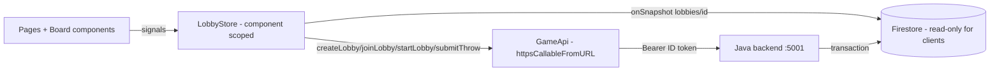

# DartBoard Online (Angular client)

- Angular 22, standalone components, `OnPush`, Signals, `@if`/`@for`, Signal Forms
- Angular Material (M2 dark theme from the template) + Bootstrap 5
- Firebase JS SDK 13 (modular): Anonymous Auth, Firestore `onSnapshot` (read-only), callables via `httpsCallableFromURL`
- PWA (service worker in production builds), DE/EN i18n, sounds + explosion animations, fullscreen + wake lock

## Architecture



| Path | Responsibility |
|------|----------------|
| `src/app/core/firebase.ts`, `firestore.ts`, `functions.ts` | Emulator-aware Firebase DI tokens (Firestore/Functions only in the lazy game chunk) |
| `src/app/core/auth-session.ts`, `auth.guard.ts` | Anonymous sign-in with display name (`name` claim), UX route guard |
| `src/app/game/game-api.ts` | The only write path: typed callables, lobby-id validation, scores never sent |
| `src/app/game/lobby-sync.ts` | `onSnapshot` on `lobbies/{id}` and `turns/` (with `includeMetadataChanges`) |
| `src/app/game/lobby-store.ts` | Read-only game state, `canThrow` lock, pending turn, safe resubmit, token refresh |
| `src/app/game/turn-preview.ts` | UX-only mirror of 501 double-out (decides when a turn is complete) |
| `src/app/game/board/*` | Dart pad, scoreboard, turn status (ported template look) |
| `src/app/features/home`, `features/game` | Start page (name, create, join) and `/game/:lobbyId` |
| `src/app/core/ux/*`, `core/i18n/*` | Toolbar, sounds/explosions, fullscreen/wake lock, PWA install, DE/EN |

Security model: the client never writes game state. `firestore.rules` (backend repo) deny all client writes;
the backend verifies the ID token, validates every dart and enforces turn order. Locks in the UI are UX only.

## Local development (no cloud costs)

Prerequisites: Node `^22.22.3 || >=24.15` (Angular 22), a JDK 21 for the Firestore emulator, the backend repo.

```powershell
# Terminal 1 - emulators (Firestore 8080, Auth 9099, UI 4000), in dard-board-backend
$env:JAVA_HOME = "<path to a JDK 21>"; $env:PATH = "$env:JAVA_HOME\bin;$env:PATH"
npx -y firebase-tools@latest emulators:start --project demo-dard-board

# Terminal 2 - Java backend (callables on http://127.0.0.1:5001/api/*), in dard-board-backend
$env:FIRESTORE_EMULATOR_HOST = "127.0.0.1:8080"
$env:FIREBASE_AUTH_EMULATOR_HOST = "127.0.0.1:9099"
.\gradlew.bat quarkusDev -Dquarkus.analytics.disabled=true

# Terminal 3 - this app on http://localhost:4200 (development config = emulators)
npm install
npm start
```

Open two browser profiles (or one normal + one private window) to play against yourself.

## Tests

```powershell
npm run test:ci          # Vitest unit/component tests (Firebase faked via DI)
npx playwright install chromium
npm run e2e              # Playwright: 2 players, full game against emulators + backend (terminals 1+2 must run)
```

## Production

`npm run build` uses `src/environments/environment.ts`: fill in the Firebase web config and the deployed
callable base URL (`gcloud functions deploy ... --runtime java21`, see backend `docs/EMULATOR_SETUP.md`), and add
the hosting origin to the backend CORS list (`QUARKUS_HTTP_CORS_ORIGINS`).
